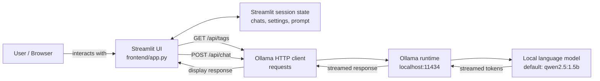

# MiniGPT Architecture

## Overview

MiniGPT is a single-process Streamlit application. The browser communicates with the Streamlit server, and the server calls Ollama's local HTTP API to discover models and generate chat responses. No separate application backend, database, or external model provider is used by the current implementation.

## Components

### Streamlit interface

`frontend/app.py` renders the chat page, sidebar, connection status, model selector, sampling controls, prompt editor, and example prompts. Streamlit reruns the script when a user interacts with a widget; session state keeps the active UI data across those reruns.

### Session state

The app stores conversations, the active conversation ID, the system prompt, temperature, top-p, and pending example prompts in `st.session_state`. Each conversation contains a title and an ordered list of user/assistant messages. This is in-memory session data, not durable storage.

### Ollama client

The app uses Python `requests` to communicate with Ollama at `http://localhost:11434`:

- `GET /api/tags` discovers locally available models.
- `POST /api/chat` sends the selected model, the system prompt, conversation messages, and generation options.

The chat request enables streaming. The app reads response lines, yields each generated content token, and passes the token stream to Streamlit for display.

### Ollama and model

Ollama hosts and runs the local model. The default model name is `qwen2.5:1.5b`; users can select other models reported by Ollama. The model must be downloaded in Ollama before it can generate responses.

## Chat request lifecycle

1. On a Streamlit script run, the app requests Ollama's model list and displays connection status.
2. The user selects a model and submits a message (or an example prompt).
3. The app appends the user message to the active conversation and builds a request containing the system prompt and conversation history.
4. It sends `model`, `messages`, `temperature`, and `top_p` to `/api/chat` with streaming enabled.
5. Generated tokens are displayed incrementally. Once generation completes, the assistant response is appended to the conversation.
6. If Ollama is offline, the request times out, or generation fails, the UI displays an error and does not retain the failed user turn.

## Configuration and boundaries

- Ollama's base URL and the default model are constants near the top of `frontend/app.py`.
- Temperature and top-p are set in the sidebar and included as Ollama generation options.
- The system prompt can be edited in the sidebar; the reset control restores the built-in default.
- There is no authentication, database, conversation export, or persistence layer in the current app.
- The Streamlit server must be able to reach the Ollama service at the configured local URL.
